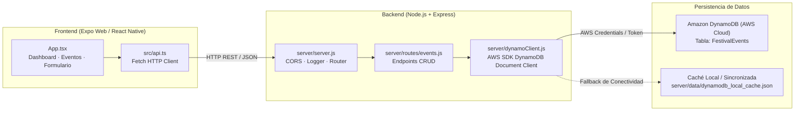

# FESTIVAL CONTROL · Fullstack Serverless (React Native + Node.js + Amazon DynamoDB)

Aplicación completa con **Backend REST** y **Persistencia en Amazon DynamoDB** (Pilar Serverless de AWS) desarrollada a partir de la identidad visual del cuaderno `04-PILARES-SERVERLESS`: fondo `#090909`, cards `#151515`, acento `#FF2F92`, confirmado `#39D98A` y retrasado `#F5C542`.

---

## 🏗️ Arquitectura del Sistema



---

## 🚀 Inicio Rápido

### 1. Instalar dependencias
```bash
npm install
```

### 2. Configurar Variables de Entorno (Opcional)
Revisa o crea tu archivo `.env` a partir de `.env.example`:
```env
PORT=3001
AWS_REGION=us-east-1
DYNAMODB_TABLE_NAME=FestivalEvents

# Si usas AWS Academy Learner Lab, copia tus credenciales temporales desde "AWS Details":
# AWS_ACCESS_KEY_ID=ASIAR...
# AWS_SECRET_ACCESS_KEY=...
# AWS_SESSION_TOKEN=...
```

> **Nota de Resiliencia:** Si las credenciales de AWS no están activas o el token de AWS Academy ha caducado, el backend conmuta de forma transparente al modo de persistencia sincronizada local (`server/data/dynamodb_local_cache.json`), garantizando que la aplicación nunca falle y los datos sigan persistiendo entre reinicios del navegador y de la app.

### 3. Ejecutar Frontend y Backend Simultáneamente
```bash
npm run dev
```
Este comando arranca:
- **Backend API:** `http://localhost:3001`
- **Frontend Web:** `http://localhost:8081`

Si deseas ejecutarlos por separado en terminales distintas:
- Backend: `npm run server` (o `npm run server:watch` para reinicio automático ante cambios)
- Frontend: `npm run web`

---

## 📡 Endpoints de la API REST

| Método | Endpoint | Descripción | Cuerpo / Parámetros |
| :--- | :--- | :--- | :--- |
| `GET` | `/api/health` | Estado del backend y de DynamoDB | Ninguno |
| `GET` | `/api/events` | Listar todos los eventos | Query: `?search=...&space=...` |
| `GET` | `/api/events/:id` | Obtener detalle de un evento | Param: `id` |
| `POST` | `/api/events` | Crear un evento en DynamoDB | `{ artist, space, time, status }` |
| `PUT` | `/api/events/:id` | Modificar un evento | `{ artist?, space?, time?, status? }` |
| `PATCH` | `/api/events/:id/status` | Ciclar o fijar estado | `{ status? }` |
| `DELETE` | `/api/events/:id` | Eliminar un evento | Param: `id` |

---

## 🧪 Pruebas de Persistencia Automatizadas

Puedes ejecutar el conjunto de pruebas sobre la API:
```bash
node server/test-api.js
```
Esto valida:
1. Conexión y healthcheck de DynamoDB.
2. Listado de eventos.
3. Creación de un evento persistente (`TECHNO TITANS`).
4. Cambio de estado a `DELAYED`.
5. Modificación de hora a `23:00`.
6. Eliminación del registro.

---

## 📦 Despliegue en AWS Amplify Hosting

```bash
npm run build:web
```
El resultado listo para producción se exporta a la carpeta `dist/`. Conecta tu repositorio de GitHub a AWS Amplify Hosting, selecciona la rama `main` y utiliza la configuración existente en `amplify.yml`.

---

## 📚 Referencia Docente
- https://github.com/albertohdezakkari/04-PILARES-SERVERLESS
